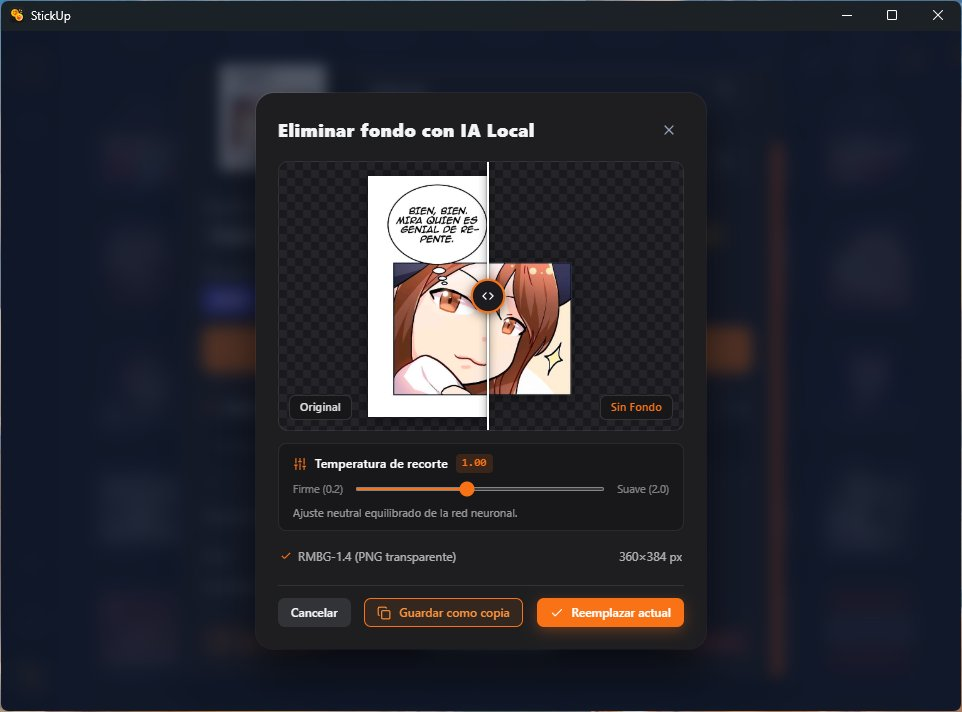

# StickUp

<p align="center">
  
</p>

<p align="center">
  <strong>Gestor nativo de emotes y stickers para escritorio: rápido, ligero y enfocado en la productividad.</strong><br>
  Construido con <strong>Tauri 2 (Rust)</strong>, <strong>SvelteKit 5 (TypeScript)</strong> y <strong>SQLite</strong>.
</p>

<p align="center">
  
  
  
  
  
  
</p>

---

**StickUp** centraliza tu biblioteca de emotes, stickers y memes, permitiéndote recortar fondos con IA local, redimensionar al vuelo y copiar en formato nativo al portapapeles para pegarlos de inmediato en **Discord, Telegram, WhatsApp Web, Slack** y cualquier otra aplicación, sin suscripciones ni dependencias en la nube.

---

## 📸 Capturas de Pantalla

| Galería y Filtros por Etiquetas | Detalle y Redimensionamiento al Vuelo |
| :---: | :---: |
|  |  |

| Recorte de Fondo con IA Local | Escáner Web y Colector DOM en Vivo |
| :---: | :---: |
|  |  |

<p align="center">
  <strong>Configuración global, notificaciones y atajos</strong><br>
  
</p>

---

## ⚡ Características Principales

### 🧠 Recorte de Fondo con IA Local
- **100% privado y offline**: Procesa las imágenes localmente mediante redes neuronales (RMBG) sin enviar datos a servidores externos.
- **Control de tolerancia y temperatura**: Ajusta la sensibilidad de corte (de firme a suave) según la complejidad del borde.
- **Previsualización interactiva**: Slider en tiempo real para comparar el original contra el resultado sin fondo antes de guardar como copia o reemplazar.

### 📋 Portapapeles Nativo Instantáneo
- **Integración nativa profunda**: Soporte Win32 `CF_HDROP` y tipos MIME nativos en Windows; `wl-clipboard` / `xclip` en Linux.
- **Pegado universal**: Pega directamente con `Ctrl+V` como archivo o imagen enriquecida en **Discord, Telegram, WhatsApp, Slack** y exploradores de archivos.
- **Gestión inteligente de animaciones**: Preserva transparencia y animación multifotograma (GIF / WebP animado) sin congelar el primer cuadro.

### 🖼️ Galería Rápida y Búsqueda por Etiquetas
- **Filtrado ultra-rápido**: Encuentra cualquier emote en milisegundos por nombre o navegando por chips interactivos de tags.
- **Telemetría y popularidad**: Destaca los emotes más usados (Top #1–20) e identifica las incorporaciones recientes (últimas 24 h).
- **Copia ágil**: Haz clic o presiona `Ctrl+C` sobre cualquier elemento para copiarlo al instante.

### 📐 Conversión y Redimensionamiento al Vuelo
- **Presets de tamaño estándar**: Escala con un clic a `Original`, `48×48`, `64×64`, `128×128`, `256×256`, `512×512` o dimensiones personalizadas mediante remuestreo `Lanczos3`.
- **Selector de formato dinámico**: Elige entre `WebP`, `PNG` y `JPG` antes de copiar.
- **Métricas de optimización en vivo**: Visualiza al instante la reducción de píxeles y el ahorro de peso (KB) respecto al archivo original.

### 🌐 Escáner Web y Colector DOM en Vivo
- **Bookmarklet interactivo**: Captura emotes en tiempo real mientras navegas por Twitch, 7TV o Discord, conservando capas transparentes y animaciones.
- **Extracción por URL o código HTML**: Analiza enlaces directos o fragmentos HTML para detectar y descargar paquetes completos de imágenes.
- **Detección de CDNs**: Reconoce variantes estáticas y animadas para descargar siempre la máxima resolución disponible.

### 🚀 Acceso Rápido y Flujo de Trabajo
- **Atajo global configurable**: Invoca u oculta la ventana principal desde cualquier aplicación (por defecto `Win + Ctrl + .`).
- **Bandeja del sistema (System Tray)**: Permanece en segundo plano con consumo mínimo de recursos.
- **Respaldos y base de datos local**: Almacenamiento SQLite persistente con backups automáticos rotativos e importación/exportación con validación de integridad.

---

## 🛠️ Stack Tecnológico

| Capa | Tecnología | Función |
| :--- | :--- | :--- |
| **Backend & Core** | **Rust** + **Tauri 2** | Rendimiento nativo, gestión de procesos IPC y portapapeles nativo Win32/Linux |
| **Motor de IA Local** | Modelo neuronal RMBG / ONNX | Segmentación y eliminación de fondos acelerada por CPU/GPU local |
| **Procesamiento de Imagen** | `image` (`webp`, `gif`, `png`, `jpeg`) | Decodificación multifotograma, reescalado con filtro `Lanczos3` y compresión |
| **Base de Datos** | **SQLite** (`rusqlite`) | Persistencia de metadatos, tags, estadísticas de uso y control transaccional |
| **Frontend** | **SvelteKit 5** + **TypeScript** + **Vite 6** | Interfaz reactiva fluida, accesible y con componentes modulares |
| **Iconografía** | **Lucide Icons** (`@lucide/svelte`) | Sistema visual coherente y liviano |

---

## 🚀 Requisitos e Instalación

### Requisitos Previos

- **Rust** (versión estable, edición 2021) vía [rustup.rs](https://rustup.rs/).
- **Node.js** (v18+) y gestor de paquetes **pnpm** (recomendado).
- **Herramientas de compilación de Tauri 2**:
  - **Windows**: Visual Studio C++ Build Tools y WebView2.
  - **Linux**: Bibliotecas de desarrollo `webkit2gtk-4.1`, `libayatana-appindicator` y `wl-clipboard` (Wayland) o `xclip` (X11).

### Modo Desarrollo

```bash
# 1. Instalar dependencias
pnpm install

# 2. Iniciar en modo desarrollo con Hot-Reload
pnpm tauri dev
```

### Compilar para Producción

```bash
# Genera el instalador nativo (.msi / .exe en Windows, .deb / AppImage en Linux)
pnpm tauri build
```

---

## 🧪 Verificación de Calidad (ODD)

El proyecto se desarrolla bajo la metodología **Organic Driven Development (ODD)** garantizando cero código muerto (*Zero Dead Code*) y tipado estricto.

Ejecutar la suite completa de verificación antes de compilar:

```bash
pnpm run prebuild
```

O verificar módulos de forma individual:

```bash
pnpm run check    # Verificación de tipos TypeScript y Svelte
pnpm run test     # Tests unitarios de frontend con Vitest
cargo test        # Tests del backend en Rust (src-tauri)
```

---

## 📄 Licencia

Distribuido bajo la licencia **MIT**. Desarrollado por [FrovaHappy](https://github.com/FrovaHappy).
