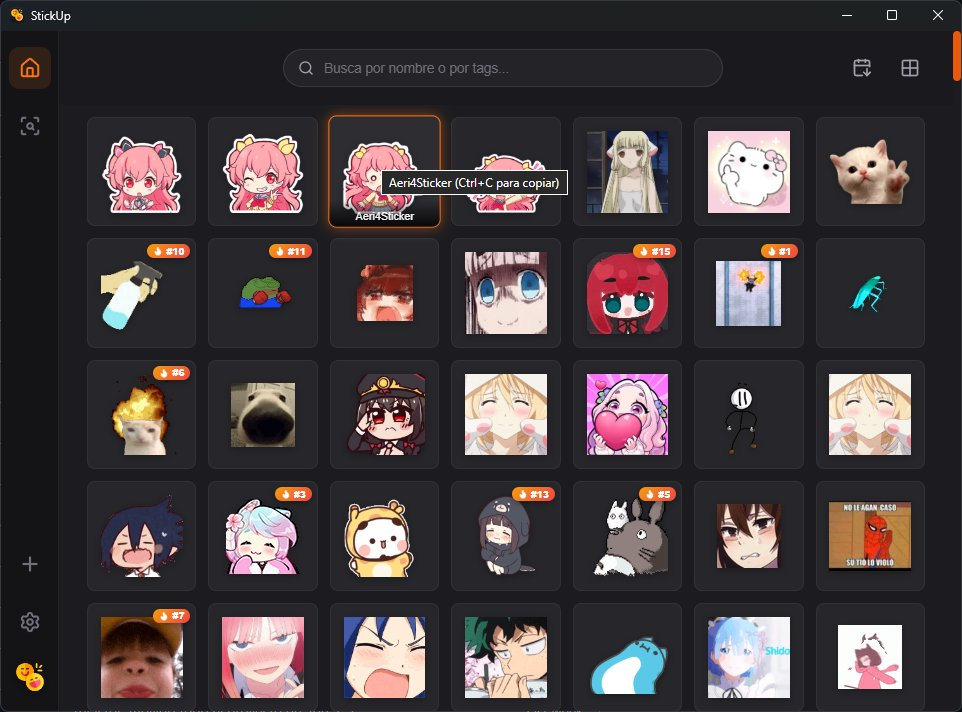
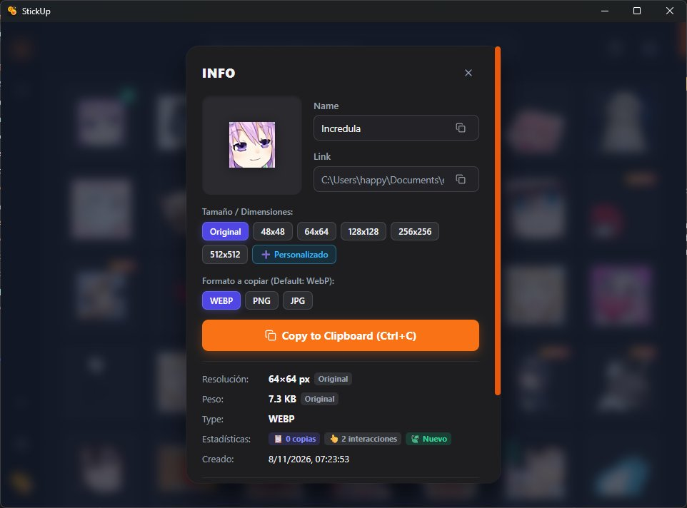
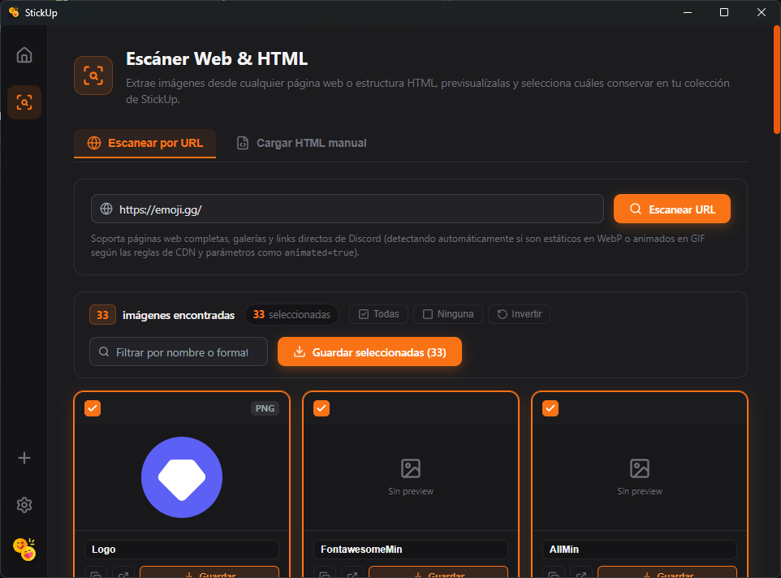
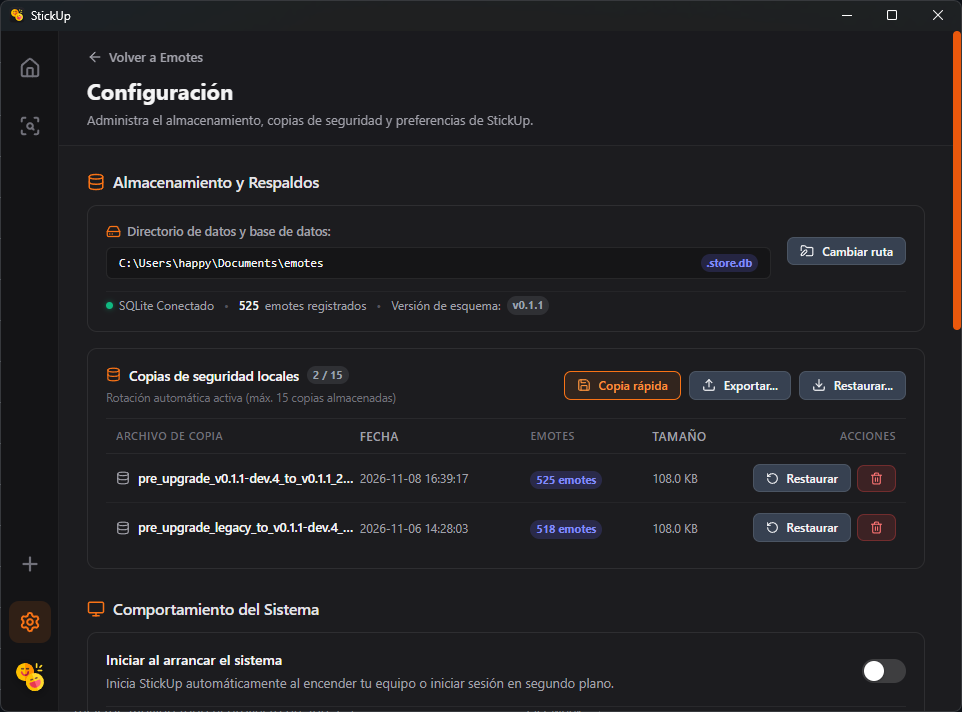

# StickUp

<p align="center">
  
</p>

<p align="center">
  <strong>El gestor de emotes y stickers definitivo para tu escritorio: rápido, ligero y multiplataforma.</strong><br>
  Construido con <strong>Tauri 2 (Rust)</strong>, <strong>SvelteKit 5 (TypeScript)</strong> y <strong>SQLite</strong>.
</p>

<p align="center">
  
  
  
  
  
  
</p>

---

**StickUp** te permite centralizar, organizar, escanear, optimizar y copiar tu colección de emotes y stickers directamente al portapapeles nativo para pegarlos al instante en **Discord, Telegram, WhatsApp Web, Slack** y cualquier otra aplicación, sin depender de suscripciones ni servidores externos.

---

## 📸 Capturas de Pantalla

| Galería y Copia Instantánea | Detalle y Redimensionamiento al Vuelo |
| :---: | :---: |
|  |  |

| Escáner Web & HTML en Acción | Configuración y Sistema de Respaldos |
| :---: | :---: |
|  |  |

---

## ✨ Características Principales

### 🖼️ Galería Reactiva y Búsqueda Instantánea
- **Búsqueda en tiempo real**: Encuentra emotes en milisegundos escribiendo parte de su nombre o filtrando por etiquetas (`tags`).
- **Insignias de popularidad dinámica**:
  - **🔥 Top #1–20**: Destaca automáticamente los emotes más utilizados según su frecuencia de copia e interacción.
  - **🍃 Nuevos**: Identifica al instante los añadidos en las últimas 24 horas.
- **Portapapeles con un clic**: Posiciona el cursor o pulsa `Ctrl+C` para copiar de inmediato en el formato nativo óptimo.
- **Visualización flexible**: Ajuste dinámico del tamaño de la cuadrícula y ordenación por fecha, popularidad o nombre.

### 🌐 Escáner Inteligente Web & HTML
- **Escaneo directo por URL**: Introduce la dirección de cualquier página, foro o galería para extraer todas las imágenes candidatas.
- **Carga de HTML manual**: Pega código HTML o sube archivos `.html` / `.htm` con resolución automática de rutas relativas mediante URL base.
- **Detección inteligente de CDNs (especial Discord)**: Detecta automáticamente si un emote es estático (WebP/PNG) o animado (GIF) según reglas de URLs, prefijos (`a_`) y parámetros (`animated=true`), descargando siempre la máxima calidad disponible.
- **Importación por lotes**: Previsualiza las imágenes encontradas, edita sus nombres sugeridos, selecciona múltiples elementos y guárdalos en masa en tu colección.

### 📋 Portapapeles Nativo Multiplataforma
- **Windows (Win32 API nativo)**:
  - Inyecta `CF_HDROP` con el archivo procesado para pegado directo e instantáneo en **Discord, Telegram, WhatsApp Web, Slack y el Explorador de Windows**.
  - Soporte de tipos MIME nativos (`image/gif`, `image/webp`, `PNG`) y `CF_DIB` para editores de imagen.
  - Gestión inteligente de GIFs: omite `CF_DIB` en animaciones para evitar que las apps de mensajería congelen el primer fotograma.
- **Linux**: Soporte nativo para **Wayland** (`wl-clipboard` / `text/uri-list`) y **X11** (`xclip` con tipos MIME).
- **Multiplataforma lista**: Diseñado con abstracciones modulares desacopladas de portapapeles.

### 💾 Almacenamiento Configurable y Sistema de Respaldos
- **Ubicación de biblioteca personalizada**: Elige libremente la carpeta donde almacenar tus emotes y la base de datos SQLite (`.store.db`), con migración y fusión automática de registros.
- **Copias de seguridad locales automáticas y manuales**:
  - Copias rápidas de base de datos con un clic.
  - **Rotación automática** con límite configurable (hasta 15 copias históricas).
  - **Respaldos preventivos automáticos**: StickUp crea un backup de seguridad antes de aplicar migraciones de esquema de base de datos (`pre_upgrade`).
  - Lista detallada con conteo de emotes, fechas, tamaños y restauración/eliminación individual.
- **Exportación e Importación**: Guarda tus copias en cualquier destino externo o restaura archivos de backup existentes con validación previa de integridad.

### 📐 Optimización, Conversión y Redimensionamiento al Vuelo
- **Modal de detalle e información rápida**: Inspecciona resolución, peso, formato original, ubicación del archivo y estadísticas de uso en tiempo real (contador de copias, interacciones e insignia de novedad).
- **Conversión inteligente de formatos**:
  - Convierte imágenes estáticas (`PNG`, `JPG`, `JPEG`) a `.webp` de alta compresión.
  - Detecta `.webp` animados multifotograma y los transforma en `.gif` compatibles con chats.
  - Preserva intactos los bucles, tiempos de retardo (`delay`) y transparencias en animaciones.
- **Presets de tamaño rápidos y dimensiones personalizadas**: Escala a `Original`, `48×48`, `64×64`, `128×128`, `256×256`, `512×512` o define un tamaño personalizado con filtro de calidad `Lanczos3`.
- **Selector de formato al copiar**: Cambia al instante entre `WebP`, `PNG` y `JPG` antes de copiar con `Ctrl+C`.
- **Previsualización de peso**: Muestra en tiempo real el tamaño estimado del archivo y el porcentaje de ahorro antes de exportar o copiar.

### ⚙️ Integración con el Sistema Operativo y Productividad
- **Atajo de teclado global**: Invoca la ventana de StickUp desde cualquier aplicación con una combinación de teclas configurable.
- **Bandeja del sistema (System Tray)**: Minimiza la aplicación al área de notificación para mantenerla siempre accesible sin ocupar espacio en la barra de tareas.
- **Inicio con el sistema**: Opción de inicio automático en segundo plano al encender el equipo.

---

## 🛠️ Stack Tecnológico

| Capa | Tecnología | Propósito |
| :--- | :--- | :--- |
| **Core / Backend** | **Rust** + **Tauri 2** | Procesamiento de imágenes de alto rendimiento, portapapeles nativo Win32/Linux e IPC seguro |
| **Base de Datos** | **SQLite** (`rusqlite` bundled) | Almacenamiento local ACID, metadatos, tags, telemetría y rotación de copias de seguridad |
| **Motor Gráfico** | `image` (`webp`, `gif`, `png`, `jpeg`) | Decodificación y codificación multifotograma, re-escalado `Lanczos3` y optimizaciones |
| **Frontend** | **SvelteKit 5** + **TypeScript** + **Vite 6** | UI moderna reactiva, fluida y altamente accesible |
| **Testing & CI** | `cargo test` + **Vitest** + `svelte-check` | Cobertura integral: tests unitarios en Rust, tests frontend y tipado estricto |

---

## 🚀 Requisitos e Instalación

### Requisitos Previos

1. **Rust** (edición 2021, canal estable) mediante [rustup](https://rustup.rs/).
2. **Node.js** (v18+) y **pnpm** (o `npm`).
3. **Dependencias del sistema para Tauri 2**:
   - **Windows**: Microsoft Visual Studio C++ Build Tools y WebView2 (incluido por defecto en Windows 10/11).
   - **Linux**: Paquetes de desarrollo de `webkit2gtk-4.1`, `libayatana-appindicator` y `wl-clipboard` (Wayland) o `xclip` (X11).

### Ejecución en Modo Desarrollo

```bash
# 1. Instalar dependencias del frontend
pnpm install

# 2. Iniciar la aplicación en modo desarrollo (Hot Reload frontend + Tauri)
pnpm tauri dev
```

### Compilación para Producción

```bash
# Valida la suite y genera el instalador nativo (.msi / .exe en Windows, .deb / AppImage en Linux)
pnpm tauri build
```

---

## 🧪 Verificación y Metodología de Desarrollo (ODD)

El proyecto sigue la metodología **Organic Driven Development (ODD)** (`Explore → Plan → Implement → Verify`), manteniendo **Zero Dead Code** y aplicando **TDD (`RED → GREEN → REFACTOR`)** en la lógica crítica de negocio.

Para ejecutar la verificación completa antes de compilar:

```bash
# Ejecutar verificación completa (svelte-check, Vitest, build de Vite y cargo test)
pnpm run prebuild
```

O paso a paso de forma independiente:

```bash
# Validación de tipos en Svelte y TypeScript
pnpm run check

# Pruebas unitarias de frontend
pnpm run test

# Pruebas unitarias del backend en Rust
cargo test --manifest-path src-tauri/Cargo.toml
```

---

## 📄 Licencia

Distribuido bajo la licencia **MIT**. Creado por [FrovaHappy](https://github.com/FrovaHappy).
